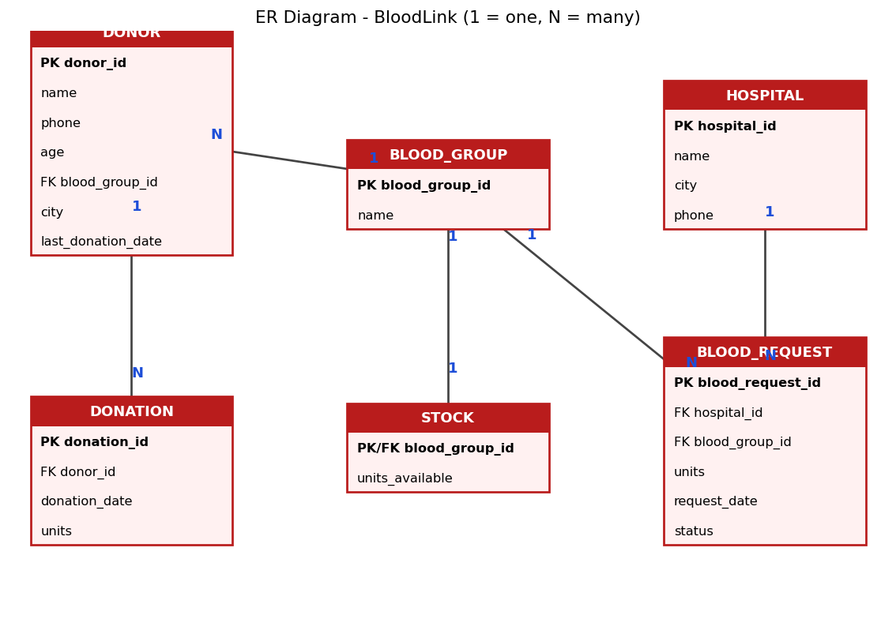

# 🩸 BloodLink – Blood Bank Management System
DBMS Mini Project · Dr. Mrudula Gudadhe · Author:Rupesh Khunkar Roll No:143

A database-driven web app (SQLite running **in the browser** via sql.js) that manages donors, donations, hospitals, blood requests and live blood stock.

**Live demo:** https://rupesh-khunkar.github.io/Bloodlink/

## Features
- Normalized (3NF) schema with PK/FK, UNIQUE and CHECK constraints
- CRUD for Blood Group, Donor, Hospital, Donation, Blood Request
- **Triggers:** 90-day donor eligibility, auto stock increase on donation, stock check and auto stock decrease on issue
- **Views:** stock, donor details, request details
- Joins, subqueries, GROUP BY, **transactions**
- Built-in **SQL Console** with 10 sample queries

## Run locally
1. git clone https://github.com/Rupesh-khunkar/Bloodlink.git
2. Open `index.html` in a browser (internet needed once for the sql.js CDN).

## Database setup
`schema.sql` has all tables, triggers, views and sample data (SQLite). For MySQL, change `AUTOINCREMENT` to `AUTO_INCREMENT` and adapt the trigger syntax.

## Structure
index.html          # app (UI + embedded schema)
schema.sql          # schema + sample data
Project_Report.pdf  # project report
er.png              # ER diagram
## ER diagram

